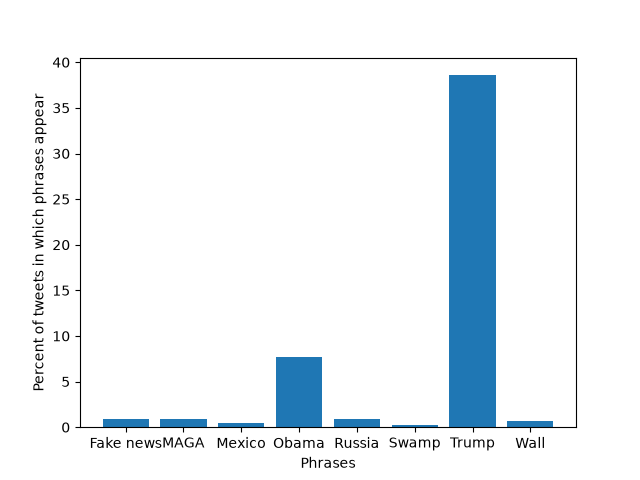

# [lab-web-data](https://csci40.rtealwitter.com/topics/05_web_scraping/lab.html)

| phrase            | percent of tweets |
| ----------------- | ----------------- |
|         Fake news | 00.88             |
|              MAGA | 00.93             |
|            Mexico | 00.45             |
|             Obama | 07.73             |
|            Russia | 00.91             |
|             Swamp | 00.29             |
|             Trump | 38.58             |
|              Wall | 00.68             |

This graph and chart shows that, of the phrases we searched for, "Trump" was included in the greatest share of Trump's tweets from 2009 to 2018 and "Obama" was included in the second greatest share. The results partially allign with my prediction, in that I predicted that "Trump"  and "Obama" would be some of the most common phrases (considering the time periods the tweets were scraped from). However, I was also suprised by the results in some ways. Particuarly, I thought that "fake news" would be more common.